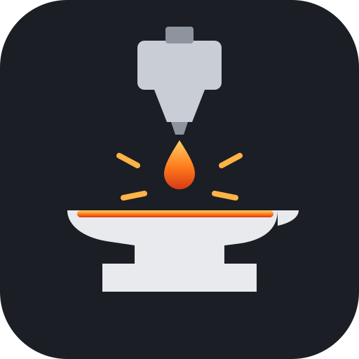

<p align="center"></p>

# SV06 Reforged

Custom firmware for the **original Sovol SV06** (board V131, GD32F103RET6, 128x64 mono screen with a knob).
It is Marlin 2.1.2.9 with Sovol's stock settings, plus input shaping, linear advance, a redesigned status screen
and a handful of quality-of-life features.

Not affiliated with Sovol. Not for the SV06 Plus or the SV06 ACE.

## Features

- **Same safe base as stock.** Steps, currents, thermistors, probe offset, homing sensitivity, speeds and
  accelerations are Sovol's V2.0.0_A values. A safety script checks every build against Sovol's source.
- **Input shaping and linear advance** with Sovol's own V2.2.0 values (X/Y 40.3 Hz, damping 0.15, K 0.02),
  so Sovol's "High-Speed" Orca profile works as intended.
- **Status screen**
  - Time left and elapsed, both large.
  - Progress bar with the percentage inside.
  - Long file names scroll.
  - Heater icons fill with the power the heater gets.
  - Target temperatures shown while heating.
  - Progress and time left come only from the slicer's `M73` lines, so they don't jump around during heat-up.
- **Menus that follow the printer's state.** Idle, printing and paused each show only what makes sense; a paused
  print can't be levelled or moved by accident.
- **Heat prompts like stock Sovol.** Auto Home and Level Bed ask before heating to 120/60 °C, and repeated clicks
  are ignored while one runs. Move Extruder offers to heat a cold nozzle.
- **Mesh always on.** The bed mesh is applied after every `G28`; no `M420 S1` is needed in the start G-code.
- **Night mode.** Caps speed (70 mm/s), acceleration (600 mm/s²) and jerk for quiet overnight prints, even when
  the G-code asks for more, and mutes the beeper.
- **Delayed start.** Pick a file, choose "Start later" (30 min to 24 h), and the status screen counts down.
- **Printed marks.** Files you printed to the end get a check mark (or a count) in the file list.
- **Spool tracker.** Grams left for PLA and PETG, counted from what the extruder actually pushed. The type comes
  from the file (`; filament_type`) or the nozzle temperature. A warning appears when a file needs more than is left.
- **Boot logo**, and fixes for two stock-board problems: the watchdog firing during EEPROM saves, and the
  `tone()` reset on every knob click.

## Install

1. Download the `.bin` from [Releases](../../releases).
2. Follow [docs/FLASHING.md](docs/FLASHING.md): copy it to the root of a FAT32 microSD card (16 GB or smaller)
   under a **name the printer has never seen**, insert, power on, and wait about 30 seconds.
3. If the screen shows an EEPROM alert, choose Reset. It loads the defaults. Then set your Z offset again and
   run Level Bed.
4. Go through [docs/FIRST_BOOT.md](docs/FIRST_BOOT.md) before the first print.

Going back to stock firmware works the same way with Sovol's file from the
[Sovol wiki](https://wiki.sovol3d.com/en/SV06). The bootloader is never touched, so flashing can always be undone.

Questions? See the [FAQ](docs/FAQ.md).

**Tip:** if the printer stays on a blue screen at power-on, reseat the SD card until it clicks. Always eject the
card in your OS before pulling it.

## Building

```sh
uv tool install platformio
pio run -d firmware                      # env GD32F103RET6_sovol_maple
git clone https://github.com/Sovol3d/Sv06-Source-Code sovol-stock   # reference for the safety check
uv run --no-project tools/safety_check.py --bin
```

The safety check must pass before a build goes on a printer. It verifies three things:
- no value is hotter, faster or stronger than Sovol's;
- the watchdog is on;
- the firmware is at most 233,472 bytes (the GD32 runs the upper flash too slowly) and starts at 0x08007000,
  above the bootloader.

## Docs

| File | What |
|---|---|
| [docs/FAQ.md](docs/FAQ.md) | Common questions |
| [docs/FLASHING.md](docs/FLASHING.md) | Flashing, troubleshooting, rollback |
| [docs/FIRST_BOOT.md](docs/FIRST_BOOT.md) | Checks after the first flash |
| [docs/FEATURE_TEST.md](docs/FEATURE_TEST.md) | Checklist for every feature |
| [docs/RESEARCH.md](docs/RESEARCH.md) | Stock firmware versions, community findings |
| [DECISIONS.md](DECISIONS.md) | Why things are the way they are |

## License

GPL-3.0, like Marlin. See [LICENSE](LICENSE). Marlin is © the Marlin Firmware contributors; the SV06 base
configuration comes from Sovol's published source and `MarlinFirmware/Configurations`.

Use at your own risk: you flash this to your own printer, and you stay near it on the first prints.
