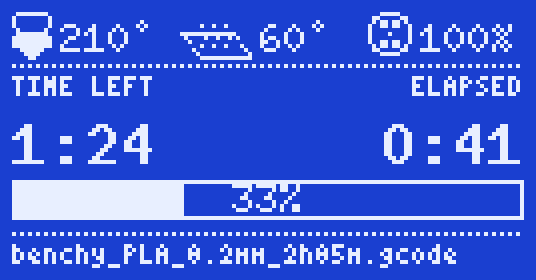
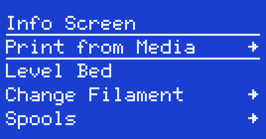

<p align="center"></p>

# SV06 Reforged

Custom firmware for the **original Sovol SV06** (board V131, 128x64 screen with a knob), built on Marlin 2.1.2.9
and Sovol's stock settings.

Not affiliated with Sovol. Not for the SV06 Plus or the SV06 ACE. No filament runout sensor support (like stock
V2.0.0_A): if your printer has one, it is ignored.

## Features

- **Spool tracker.** The printer keeps track of how many grams of PLA and PETG you have left, counted from what the
  extruder actually pushed. Before a print it warns you when the file needs more than is left.
- **Night mode.** One switch in the menu makes printing slow and quiet for overnight prints, whatever the file asks
  for, and mutes the beeper.
- **Delayed start.** Pick a file, choose "Start later" (30 minutes to 24 hours), and the screen counts down. At the
  chosen time the printer heats and prints on its own, so only use it for prints you'd leave unattended anyway.
- **Printed marks.** Files you printed to the end get a check mark, or a count, in the file list.
- **Redesigned status screen.** Large time left and elapsed time, a progress bar with the percentage inside,
  heater icons that fill with the power they get, and long file names that scroll.

  

- **Rearranged menus for everyday features.** Print, Level Bed, Change Filament, Spools and Night Mode sit at the
  top of the main menu. During a print it shows Pause, Night Mode, Stop and Tune.

  

- **Input shaping and linear advance** for cleaner corners at speed.
- **Bed mesh always on.** The mesh is applied after every homing, with no extra start G-code needed.

## FAQ

### Which printers does this work on?
Only the original Sovol SV06: board V131 with a GD32F103RET6 chip, a 128x64 monochrome screen and a knob.

### Can it brick my printer?
Very unlikely. Flashing from the SD card replaces only the firmware; the bootloader that reads the card is not
touched, so you can go back by flashing Sovol's file the same way. In rare cases (bad card, loose display cable) it
takes some troubleshooting, see [docs/FLASHING.md](docs/FLASHING.md). You flash at your own risk.

### Do I need to change my slicer profile?
No. Sovol's OrcaSlicer profiles work as they are.

### After flashing I get an EEPROM alert. Is something broken?
No. The settings saved by the previous firmware have a different layout. Choose Reset, wait about 10 seconds,
then enter your Z offset again and run Level Bed.

### The printer stays on a blue screen at power-on.
A blank or blue screen for about 30 seconds while flashing is normal. If it stays blue for more than a minute, the
card isn't being read: power off, push the card fully into the slot until it clicks, and power on. Always eject
the card in your operating system before pulling it out.

## Install

1. Before flashing, do section 0 of [docs/FIRST_BOOT.md](docs/FIRST_BOOT.md): write down your Z offset, and check
   that Sovol's stock file flashes from your card. Switching firmware resets the stored settings (Z offset, bed
   mesh, heater tuning).
2. Download the `.bin` from [Releases](../../releases).
3. Follow [docs/FLASHING.md](docs/FLASHING.md): copy it to the root of a FAT32 microSD card (16 GB or smaller)
   under a **name the printer has never seen**, insert it, power on, and wait about 30 seconds.
4. If the screen shows an EEPROM alert, choose Reset. Then set your Z offset again and run Level Bed.
5. Go through [docs/FIRST_BOOT.md](docs/FIRST_BOOT.md) before the first print.

Going back to stock firmware works the same way, with Sovol's file from the
[Sovol wiki](https://wiki.sovol3d.com/en/SV06).

## Building

```sh
uv tool install platformio
pio run -d firmware                      # env GD32F103RET6_sovol_maple
git clone https://github.com/Sovol3d/Sv06-Source-Code sovol-stock   # reference for the safety check
uv run --no-project tools/safety_check.py --bin
```

The safety check must pass before a build goes on a printer. It checks three things:
- no value is hotter, faster or stronger than in Sovol's stock firmware;
- the watchdog is on;
- the firmware is at most 233,472 bytes (the GD32 runs the upper flash too slowly) and starts at 0x08007000,
  above the bootloader.

## License

GPL-3.0, like Marlin. See [LICENSE](LICENSE). Marlin is © the Marlin Firmware contributors; the SV06 base
configuration comes from Sovol's published source and `MarlinFirmware/Configurations`.

Use at your own risk: you flash this to your own printer, and you stay near it on the first prints.
